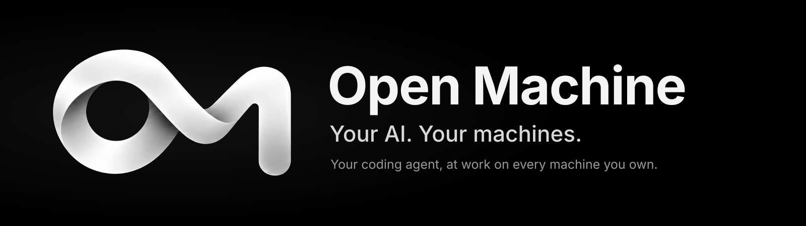
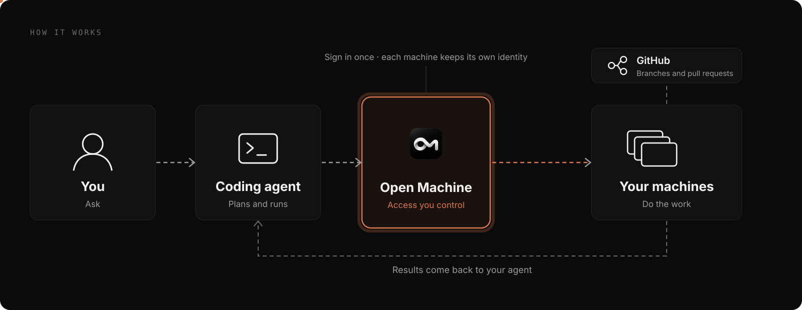
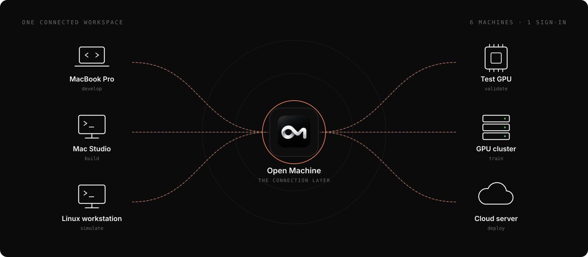

**Your AI. Your machines.** 
Let your coding agent work on every machine you own, with the access you choose.

 

  

Ask your coding agent for work that belongs on another machine: train on the GPU
server, build on the workstation, test on the spare Mac. It reaches that machine,
does the work there and brings the results back to you, while you stay where
you are.

[GitHub Issues](https://github.com/OpenMachineLabs/openmachine/issues) · [Contributing](CONTRIBUTING.md) · [Code of Conduct](CODE_OF_CONDUCT.md)

<table aria-label="Open Machine community">
<tr>
<td align="center" width="520">
  <a href="https://discord.gg/TAxEWV7fgZ">
     
    <strong>Join the Open Machine Community</strong>
  </a> 
  Discord · Q&amp;A · Show and Tell
</td>
</tr>
</table>

## Put your AI to work

<table>
<tr>
<td width="33%" valign="top"><b>Every machine within reach</b> Sign in once. Each machine you add is one step away from your agent, wherever it is.</td>
<td width="33%" valign="top"><b>The agent you already use</b> Keep your coding agent and your workflow. It works on other machines the way it works on this one.</td>
<td width="33%" valign="top"><b>Power under your control</b> Decide how far your agent can reach on each machine, and change it any time.</td>
</tr>
</table>

## How it works

  

1. **You ask.** Tell your coding agent what you need, as you do today.
2. **Open Machine connects.** Your agent reaches the right machine through your
   account. Each machine keeps its own identity, and only your machines answer.
3. **Your machines do the work.** Results come back to your agent. Branches and
   pull requests go to GitHub through your account, with no tokens left on the
   machine.

## Connect all your machines

  

Your laptop, your desk machine, the GPU box and the build server become one
workspace. Add a machine with the Open Machine app, turn it on, and your agent
can use it.

## Power under your control

  

| Access | What your agent can do |
| --- | --- |
| **Full access** | Work as you do on that machine. |
| **Selected projects** | Change only the projects you pick. Keys, other apps' data and Open Machine itself stay out of reach. |
| **Read only** | Look around, build and test, without changing your files. |

Turn a machine off and your agent can no longer reach it. Remove it and it is
gone from your account.

## Get started

1. Download the Open Machine app from [openmachine.app](https://openmachine.app) (macOS).
2. Sign in and turn it on, on each machine you want to use.
3. Ask your coding agent to work on one of them.

## This repository

This is **Open Machine Core**, the open-source part of Open Machine that runs on
each of your machines. It starts your agent's work there and applies the access
you chose. The app installs and updates it for you. To build or change Core,
read [CONTRIBUTING.md](CONTRIBUTING.md).

## Security

Full access means your agent can do anything you can on that machine; choose it
only for machines where that is what you want. Selected projects and Read only
rely on the macOS sandbox. Report vulnerabilities privately through the
[Security Policy](SECURITY.md).

## Contributors

Thanks to everyone who contributes to Open Machine.

[Contribute to Open Machine](CONTRIBUTING.md) · [Maintainer guide](MAINTAINERS.md) · [Code of Conduct](CODE_OF_CONDUCT.md)

## License

[MIT](LICENSE) © 2026 OpenMachineLabs.
