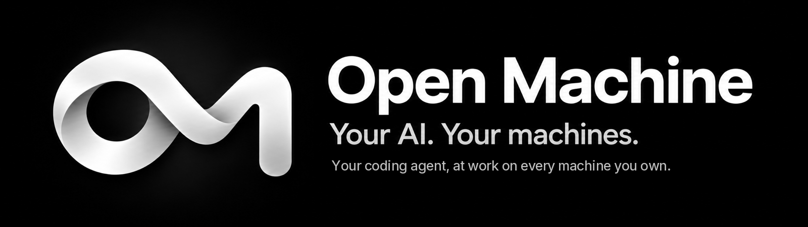

<div align="center">

# Open Machine

### One agent. Every machine. Real execution.

**An open-source platform that lets your coding agent work on every machine you own.**

<a href="https://openmachine.app"></a>
<a href="https://www.python.org/downloads/"></a>
<a href="LICENSE"></a>
<a href="https://discord.gg/TAxEWV7fgZ"></a>
<a href="https://x.com/OpenMachineAI"></a>



<a href="https://openmachine.app/download"><picture><source media="(prefers-color-scheme: dark)" srcset="assets/button-download-dark.svg" /></picture></a>
<a href="https://console.openmachine.app"><picture><source media="(prefers-color-scheme: dark)" srcset="assets/button-console-dark.svg" /></picture></a>
<a href="https://openmachine.app"><picture><source media="(prefers-color-scheme: dark)" srcset="assets/button-website-dark.svg" /></picture></a>

</div>

<br />

<p align="center">
  
</p>

Your coding agent already works on this machine. Open Machine lets it work on
all of them: train on the GPU machine, build on the workstation, test on the
spare Mac, with each machine's results coming back to you.

**Yours, end to end.** Machines connect peer-to-peer over encrypted WireGuard,
built on Tailscale. You choose how far the agent reaches on each machine, and
GitHub tokens never sit on your machines.

## Quick start

1. [Download](https://openmachine.app/download) the app and sign in on each machine.
2. Choose access per machine: **Read only**, **Selected projects** or **Full access**.
3. Ask your coding agent. It reaches a machine with one command:

   ```bash
   ssh studio.om
   ```

## How it fits together

- **App**: signs each machine in and keeps it reachable.
- **Console**: your machines, members and access, in one place.
- **Network**: a private WireGuard network between your machines.
- **Core** (this repository): starts the agent's work on each machine with the access you chose.

## Contributors

Thanks to everyone who contributes to Open Machine.

<a href="https://github.com/OpenMachineLabs/openmachine/graphs/contributors">
  
</a>

[View GitHub contributors](https://github.com/OpenMachineLabs/openmachine/graphs/contributors) · [Contribute to Open Machine](CONTRIBUTING.md) · [Maintainer guide](MAINTAINERS.md)

## License

[MIT](LICENSE) © 2026 OpenMachineLabs.
