<div align="center">

# Open Machine

### One agent. Every machine. Real execution.

**Let your coding agent work on every machine you own, with the access you choose.**

<a href="https://openmachine.app"></a>
<a href="https://www.python.org/downloads/"></a>
<a href="LICENSE"></a>
<a href="https://discord.gg/TAxEWV7fgZ"></a>
<a href="https://x.com/OpenMachineAI"></a>


<a href="https://openmachine.app/download"><picture><source media="(prefers-color-scheme: dark)" srcset="assets/button-download-dark.svg" /></picture></a>
<a href="https://console.openmachine.app"><picture><source media="(prefers-color-scheme: dark)" srcset="assets/button-console-dark.svg" /></picture></a>
<a href="https://openmachine.app"><picture><source media="(prefers-color-scheme: dark)" srcset="assets/button-website-dark.svg" /></picture></a>

</div>

<br />

Your coding agent already works on this machine. Open Machine lets it work on
all of them: train on the GPU machine, build on the workstation, test on the
spare Mac, with each machine's results coming back to you.

**Under your control.** Machines connect peer-to-peer over encrypted WireGuard,
using the open-source Tailscale client with Open Machine's own coordination
server and relays. You choose how far the agent reaches on each machine, and
GitHub tokens never sit on your machines.

<p align="center">
  
</p>

## Quick start

On a Mac with Apple Silicon (macOS 13 or later):

1. [Download](https://openmachine.app/download) the app and sign in on each machine.
2. Choose access per machine: **Read only**, **Workspace** or **Full access**.
3. Ask your coding agent. It reaches a machine with one command:

   ```bash
   ssh studio.om
   ```

On Linux, add a machine from the [Console](https://console.openmachine.app),
which gives you a command like this one:

```bash
curl -fsSL https://openmachine.app/install.sh | sh -s -- --key omkey_...
```

Then `om status` shows its state, and `om down` and `om up` take it offline
and back online.

## What is in this repository

Everything that decides what happens on your machine is open source, here:

| Part | Source | Does |
| --- | --- | --- |
| `om` | [`cmd/om`](cmd/om), [`daemon/`](daemon), [`linux/`](linux) | Joins the private network, serves OM SSH, matches rules, records logs, relays Git to GitHub without a token on the machine; on Linux, also installs, updates and runs the product. See [docs/om.md](docs/om.md). |
| Device identity | [`device/`](device) | This machine's key, sign-in and sign-out, its permission, and the bundle it runs. See [docs/device.md](docs/device.md). |
| Core | [`access/`](access) | Starts each session with the access you chose: Read only or Workspace, sandboxed with macOS Seatbelt or Linux bubblewrap, or Full access, which is not sandboxed. |
| Network library | [`connector/`](connector) | Joins one device to the private network; a Go module of its own. |

Closed source, run by us:

- **The Mac app**: sign-in, settings and installation on macOS. What it does and does not do: [docs/mac-app.md](docs/mac-app.md).
- **The service**: accounts, teams, policy and rule authoring, the coordination server and relays, log storage, and the Console.

What the engine does and does not guarantee is in [SECURITY.md](SECURITY.md).

## Build and test

```bash
go build ./cmd/om
go test ./...
```

[CONTRIBUTING.md](CONTRIBUTING.md) has the other checks and how to send a
change; [docs/device.md](docs/device.md#setup-and-the-bundle) has the bundle
build.

## Versions

The repository has one version, in [`access/openmachine_access/__init__.py`](access/openmachine_access/__init__.py).
A release tags one commit with both `vX.Y.Z` and `connector/vX.Y.Z`; tags are
never moved. Before 1.0, the Go packages make no API stability promise.

## Contributors

Thanks to everyone who contributes to Open Machine.

<a href="https://github.com/OpenMachineLabs/openmachine/graphs/contributors">
  
</a>

[View GitHub contributors](https://github.com/OpenMachineLabs/openmachine/graphs/contributors) · [Contribute to Open Machine](CONTRIBUTING.md)

## License

Copyright 2026 Open Machine Technologies, Inc. Licensed under
[Apache-2.0](LICENSE); see [NOTICE](NOTICE),
[third-party licenses](THIRD_PARTY_LICENSES.md) and [trademarks](TRADEMARKS.md).
Versions before 0.2.31 keep the license they were released under.
