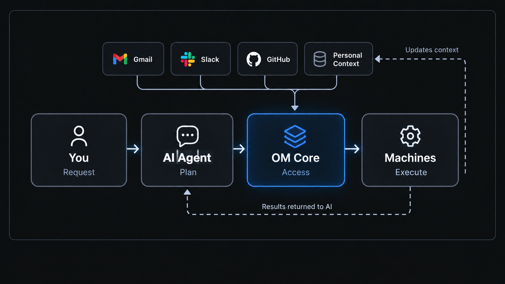

<div align="center">

# Open Machine

### One MCP. Every machine. Real execution.

**An open-source runtime that lets your existing AI agent operate your machines.**

<a href="openmachine/skills/overview/SKILL.md"></a>
<a href="https://www.npmjs.com/package/openmachine"></a>
<a href="https://www.python.org/downloads/"></a>
<a href="LICENSE"></a>
<a href="https://discord.gg/TAxEWV7fgZ"></a>
<a href="https://x.com/OpenMachineAI"></a>


</div>

https://github.com/user-attachments/assets/f22519e6-e3ad-405c-a725-9ce53a642bcc

**Open Machine (OM Core)** connects your existing AI Agents to your machines through a local-first MCP runtime. Your AI plans the work; OM provides permission-controlled tools to carry it out and return results.

[GitHub Issues](https://github.com/OpenMachineLabs/openmachine/issues) · [Contributing](CONTRIBUTING.md) · [Code of Conduct](CODE_OF_CONDUCT.md)

<div align="center">

<table aria-label="Open Machine community">
<tr>
<td align="center" width="520">
  <a href="https://discord.gg/TAxEWV7fgZ">
    <br />
    <strong>Join the Open Machine Community</strong>
  </a><br />
  <sub>Discord · Q&amp;A · Show and Tell</sub>
</td>
</tr>
</table>

</div>

## What you can do

| Capability | Description |
| --- | --- |
| Local machines and context | Inspect the selected machine, project and environment before acting. |
| Workspace files and worktrees | Read, search and apply guarded edits in the intended tree. |
| Native commands and terminals | Execute authorized commands, observe results and verify cleanup. |
| Persistent tasks | Record goals and evidence, then explicitly continue interrupted work. |
| GitHub | Work with scoped repositories, Issues, PRs, reviews, Projects and Releases. |
| Browser subtasks | Delegate bounded web tasks through a compatible native Codex installation. |
| Skills | Discover packaged operating guides and reviewed external Skill roots. |
| Service and runtime | Manage the macOS service, retained updates and compatible rollback. |

**Long-running jobs and task continuation:** Already-started jobs can keep running after the AI client's conversation disconnects. A job's execution status (running, completed, or failed) is separate from whether the client is ready to continue or needs user input. Finishing a job **does not automatically wake the client or start the next stage**. For a structured task, keep the original Task ID to review results and explicitly continue the remaining authorized work without rerunning completed steps.

## Quick start

**macOS Apple Silicon (macOS 13+, Node.js 24 LTS recommended; Node.js 22 LTS also supported)**

```bash
npm install -g openmachine@latest
openmachine
```

On first run, choose an existing project folder containing a readable file (such as `README.md`). Open Machine sets up Core and starts a managed macOS user service that keeps running after you close the terminal. Check it with `openmachine status`.

Optionally enable startup at login:

```bash
openmachine startup on
```

The npm-managed route is the default and only supported consumer installer today. The package currently targets Apple Silicon macOS; Linux and other source-based setups remain developer/advanced paths until npm packages for those platforms are published. Windows is not supported.

Open Machine works with any MCP-capable AI client. Configure and verify that client's connection separately; the npm installer does not set up an MCP tunnel or approve client tools. Command execution and workspace writes are **disabled by default**.

The npm `openmachine` command manages setup and service status; `openmachine core ...` runs the underlying Python CLI. See the [npm installer README](npm/README.md).

This is an early-development release, not a stable 1.x release.

**Updating?** Use the same npm-managed path for both launcher and running Core. See the [npm installer README](npm/README.md).

```bash
npm install -g openmachine@latest
openmachine update
```

## How it works

<p align="center">
  
</p>

Your request flows from **AI Agent → OM Core → your machines**, and execution results return to your AI. OM exposes the approved tools; it does not replace your AI agent.

The **Personal Context layer and automatic context updates** in the diagram illustrate planned functionality for bringing data from sources such as Gmail and Slack into OM and keeping it up to date as tasks are completed.

## Technical references

The [operating Skill](openmachine/skills/overview/SKILL.md) and [Skills directory](openmachine/skills/README.md) are technical references for AI agents. The [npm installer README](npm/README.md) describes distribution and service setup. A source checkout, published release, running runtime and approved client catalog can differ; read the running version's guide before acting.

## Security

Open Machine is a trusted, single-operator native runtime, **not an OS sandbox** or multi-tenant executor. Native commands can access resources beyond read-only tool scopes. Keep the listener private, grant access deliberately, and remember that files and logs returned to an AI client may leave your machine. Cancellation and software rollback do not undo completed effects. Never put secrets in prompts, command arguments or committed configuration. Report vulnerabilities privately via the [Security Policy](SECURITY.md).

## Contributors

Thanks to everyone who contributes to Open Machine.

<a href="https://github.com/OpenMachineLabs/openmachine/graphs/contributors">
  
</a>

[View GitHub contributors](https://github.com/OpenMachineLabs/openmachine/graphs/contributors) · [Contribute to Open Machine](CONTRIBUTING.md) · [Maintainer guide](MAINTAINERS.md)

## License

[MIT](LICENSE) © 2026 OpenMachineLabs.
