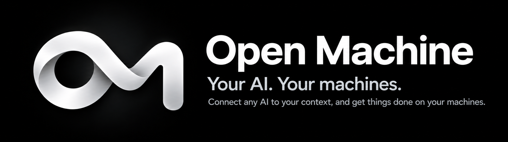
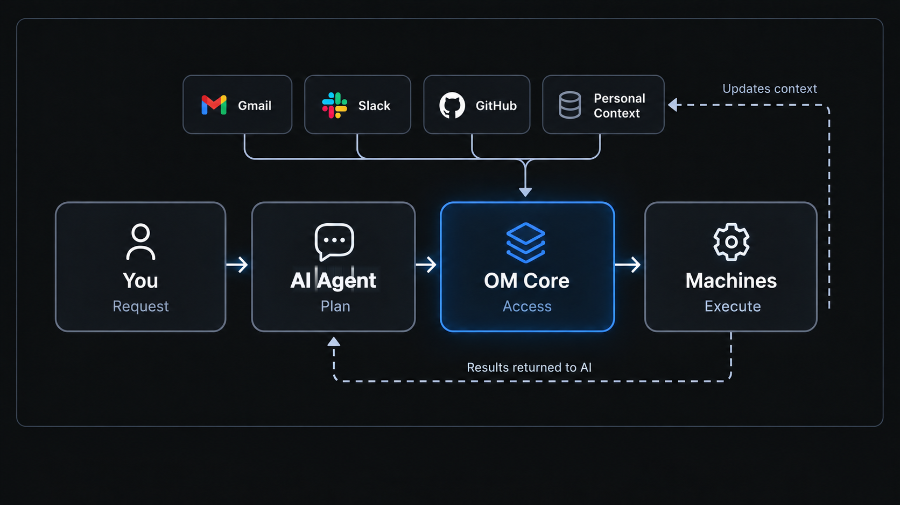

<div align="center">

# Open Machine

### One MCP. Every machine. Real execution.

**An open-source runtime that lets your existing AI agent operate your machines.**

<a href="openmachine/skills/overview/SKILL.md"></a>
<a href="https://www.python.org/downloads/"></a>
<a href="LICENSE"></a>
<a href="https://discord.gg/TAxEWV7fgZ"></a>
<a href="https://x.com/OpenMachineAI"></a>




<br /><br />

<table aria-label="Open Machine community">
<tr>
<td align="center" width="520">
  <a href="https://discord.gg/TAxEWV7fgZ">
    <br />
    <strong>Join the Open Machine Community</strong>
  </a><br />
  <sub>Discord · Q&amp;A · Show and Tell</sub>
</td>
</tr>
</table>

</div>

**Open Machine (OM Core)** connects your existing AI Agents to your machines through a local-first MCP runtime. Your AI plans the work; OM provides permission-controlled tools to carry it out and return results.

[Documentation](docs/index.md) · [Getting started](docs/getting-started/installation.md) · [GitHub Issues](https://github.com/OpenMachineLabs/openmachine/issues) · [Contributing](CONTRIBUTING.md) · [Code of Conduct](CODE_OF_CONDUCT.md)

## What you can do

| Capability | Guide |
| --- | --- |
| Local machines and context | [Inspect the intended project and environment](docs/features/local-machine.md) before acting. |
| Workspace files and worktrees | [Read, search and apply guarded edits](docs/features/workspace.md) in the intended tree. |
| Native commands and terminals | [Run commands, retrieve original results and verify cleanup](docs/features/execution.md). |
| Remote Linux over SSH | [Prepare workers, pin identity and operate remote projects](docs/features/ssh.md). |
| Persistent tasks | [Keep goals, stages and evidence; continue original work explicitly](docs/features/tasks.md). |
| GitHub | [Use scoped repositories, Issues, PRs, reviews, Projects and Releases](docs/features/github.md). |
| Browser subtasks | [Delegate a bounded web task](docs/features/browser.md) through a compatible, authorized native Codex installation. |
| Skills | [Discover packaged operating guides and reviewed external Skill roots](docs/features/skills.md). |
| Service and runtime | [Manage the macOS service, retained updates and compatible rollback](docs/features/service.md). |

Tasks preserve progress and observe admitted work; they **do not automatically wake ChatGPT or execute the next stage after a chat disconnects**. Optional integrations have separate prerequisites. See [current limitations](docs/introduction/limitations.md).

## Quick start

**Requirements:** Python 3.12+, Git, and a compatible SQLite version on macOS or Linux. Check the [exact SQLite requirements and platform limits](docs/introduction/requirements.md) with the Python interpreter you will use.

Build from the pinned `v0.2.21` release tag. Before public repository access is enabled, cloning requires repository permission. Use a directory without an existing `openmachine` clone:

```bash
git clone --branch v0.2.21 --depth 1 https://github.com/OpenMachineLabs/openmachine.git
cd openmachine
python3 -m venv .venv
.venv/bin/python -m pip install -r requirements.lock
.venv/bin/python -m pip wheel --no-deps --no-build-isolation . --wheel-dir dist
.venv/bin/python -m pip install --no-deps dist/openmachine-0.2.21-py3-none-any.whl
.venv/bin/openmachine --version
```

Next, create a disposable, read-only workspace using [Initial configuration](docs/getting-started/configuration.md), then [Connect to ChatGPT](docs/getting-started/connect-chatgpt.md) and run the [first verified command](docs/getting-started/first-task.md).

OM serves a **private Unix socket**. Installing Core or starting `serve` does not enroll a ChatGPT account, install a tunnel or approve client tools. The supported connection, account/workspace eligibility and client approvals are separate requirements.

Command execution and workspace writes are **disabled by default** and require separate explicit grants. This is an initial-development release, not a stable 1.x release. Linux supports manual serving; Windows is not currently supported.

## How it works

<p align="center">
  
</p>

Your request flows from **AI Agent → OM Core → your machines**, and execution results return to your AI. OM exposes the approved tools; it does not replace your AI agent.

The **Personal Context layer and automatic context updates** in the diagram illustrate planned functionality for bringing data from sources such as Gmail and Slack into OM and keeping it up to date as tasks are completed.

## Documentation

The [user documentation](docs/index.md) covers every important released Core capability. Start with [requirements](docs/introduction/requirements.md), [installation](docs/getting-started/installation.md), [configuration](docs/getting-started/configuration.md) and [layer-by-layer verification](docs/getting-started/verification.md).

For existing installations, use [updates](docs/getting-started/updates.md), the [configuration reference](docs/configuration/reference.md) and [troubleshooting](docs/troubleshooting.md). The [CLI](docs/reference/cli.md) and [MCP tools](docs/reference/tools.md) references link to detailed operating contracts without duplicating them.

The [operating Skill](openmachine/skills/overview/SKILL.md) and [Skills directory](openmachine/skills/README.md) remain the technical starting points for AI agents. A source checkout, published release, running runtime and approved client catalog can differ; read the running version's guide before acting.

## Security

Open Machine is a trusted, single-operator native runtime, **not an OS sandbox** or multi-tenant executor. Native commands can access resources beyond read-only tool scopes. Keep the listener private, grant access deliberately, and remember that files and logs returned to an AI client may leave your machine. Cancellation and software rollback do not undo completed effects. Read [Security and data](docs/configuration/security.md) before enabling execution or remote access; never put secrets in prompts, command arguments or committed configuration. Report vulnerabilities privately via the [Security Policy](SECURITY.md).

## Contributors

Thanks to everyone who contributes to Open Machine.

[View GitHub contributors](https://github.com/OpenMachineLabs/openmachine/graphs/contributors) · [Contribute to Open Machine](CONTRIBUTING.md) · [Maintainer guide](MAINTAINERS.md)

## License

[MIT](LICENSE) © 2026 OpenMachineLabs.
