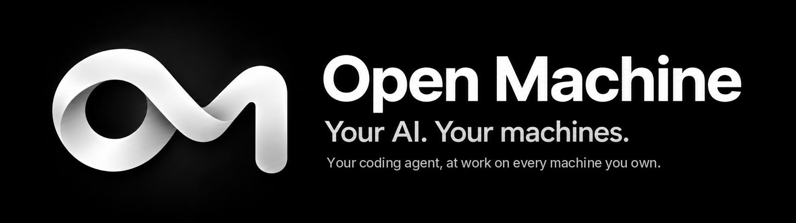
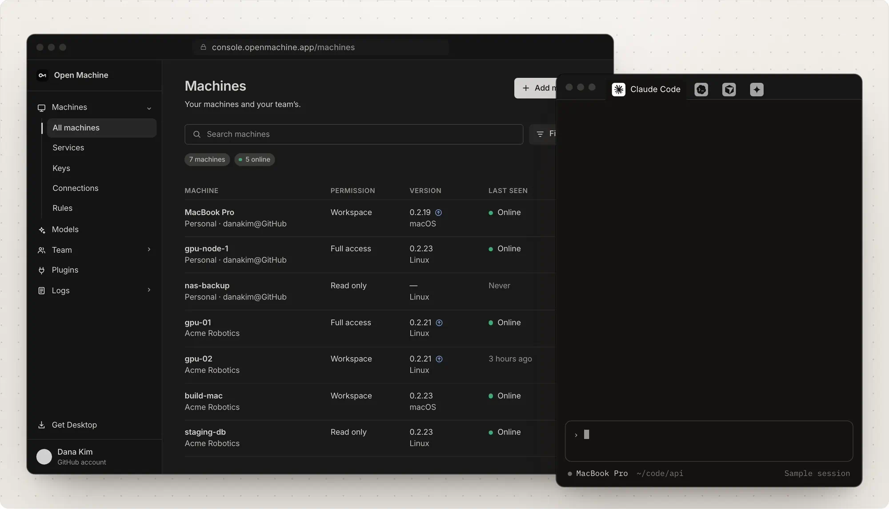
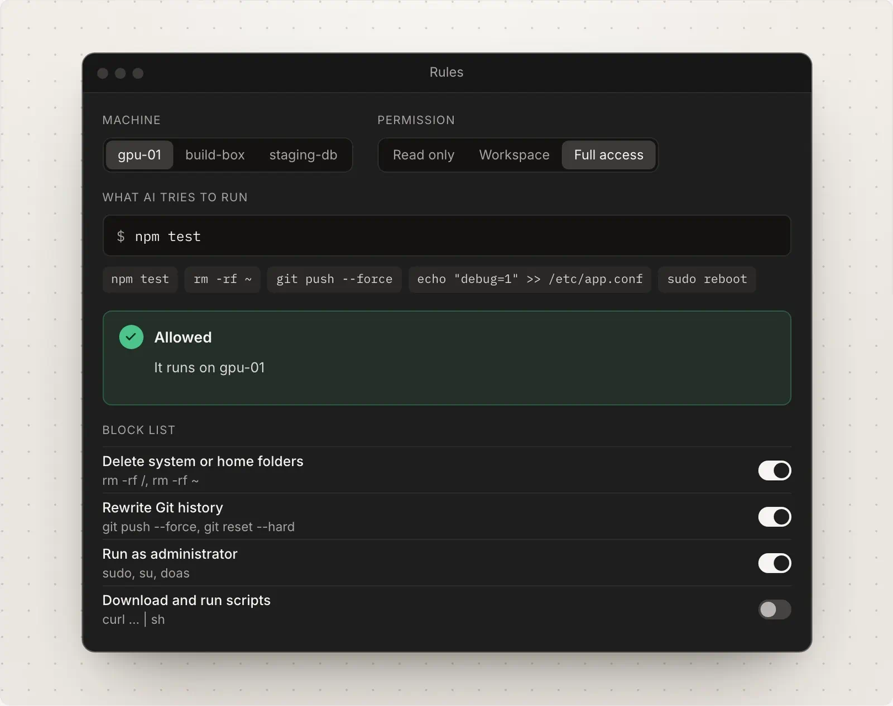

<div align="center">

# Open Machine

### Your AI. Your machines.

**Let your AI agent work on your real machines, within limits each machine enforces.**

<a href="https://openmachine.app"></a>
<a href="https://openmachine.app/docs"></a>
<a href="https://www.python.org/downloads/"></a>
<a href="LICENSE"></a>
<a href="https://discord.gg/TAxEWV7fgZ"></a>
<a href="https://x.com/OpenMachineAI"></a>



<a href="https://openmachine.app/download"><picture><source media="(prefers-color-scheme: dark)" srcset="assets/button-download-dark.svg" /></picture></a>
<a href="https://console.openmachine.app"><picture><source media="(prefers-color-scheme: dark)" srcset="assets/button-console-dark.svg" /></picture></a>
<a href="https://openmachine.app"><picture><source media="(prefers-color-scheme: dark)" srcset="assets/button-website-dark.svg" /></picture></a>

</div>

<br />

An agent with a shell can do anything its user can. Open Machine lets your
coding agent train on the GPU machine, build on the workstation and test on the
spare Mac, while you decide what it may do on each: which commands it must
never run, which folders it may change and whether it may push.

**Enforced on the machine.** `om` and Core on each machine check every new
session against your choices, and fail closed: without a current lease from the
service, which lasts at most 60 seconds, a machine admits nothing new. The
private network itself is built on Tailscale's open-source protocol: the
[network library](connector/README.md) runs Tailscale's `tsnet` library against
Open Machine's own coordination server and relays.

<p align="center">
  
</p>

Works with Claude Code, Codex, Cursor, Gemini CLI and anything that speaks SSH.

## What your agent gets

- **Rules.** Block the commands you never want run, such as deleting home
  folders or rewriting Git history. A blocked command never starts, and the
  agent is told why.
- **The access you choose.** Each machine is **Read only**, **Workspace**
  (changes only in the folders you choose) or **Full access**. Read only and
  Workspace sessions run sandboxed, in macOS Seatbelt or Linux bubblewrap;
  Full access is not sandboxed.
- **Git without a token.** On Full access machines, agents push and open pull
  requests through your GitHub connection; the token never reaches the machine.
- **A record of everything.** Every connection, command and block is recorded
  and signed by the machine that ran it, and you can check a log export on your
  own computer.
- **Your pages and models.** Open a machine's web page at
  `localhost:11400/<machine>/<port>` and point any app at the models your
  machines run, at `http://127.0.0.1:11400/v1`.
- **Every machine by name.** `ssh build-mac.om` reaches a machine over the
  private network, with no ports to open.

<p align="center">
  
</p>

How each works on the machine: [docs/om.md](docs/om.md); what it does not
guarantee: [SECURITY.md](SECURITY.md).

## Quick start

On a Mac with Apple Silicon (macOS 13 or later):

1. [Download](https://openmachine.app/download) the app and sign in on each machine.
2. Choose access per machine: **Read only**, **Workspace** or **Full access**.
3. Ask your coding agent. It reaches a machine with one command:

   ```bash
   ssh studio.om
   ```

On Linux, add a machine from the [Console](https://console.openmachine.app),
which gives you a command like this one:

```bash
curl -fsSL https://openmachine.app/install.sh | sh -s -- --key omkey_...
```

Then `om status` shows its state, and `om down` and `om up` take it offline
and back online.

The [docs](https://openmachine.app/docs) cover installation, permissions, rules
and troubleshooting in full.

## What is in this repository

Everything that decides what happens on your machine is open source, here:

| Part | Source | Does |
| --- | --- | --- |
| `om` | [`cmd/om`](cmd/om), [`daemon/`](daemon), [`linux/`](linux) | Joins the private network, serves OM SSH, matches rules, records logs, relays Git to GitHub without a token on the machine; on Linux, also installs, updates and runs the product. See [docs/om.md](docs/om.md). |
| Device identity | [`device/`](device) | This machine's key, sign-in and sign-out, its permission, and the bundle it runs. See [docs/device.md](docs/device.md). |
| Core | [`access/`](access) | Starts each session with the access you chose. |
| Network library | [`connector/`](connector) | Joins one device to the private network; a Go module of its own. |

Closed source, run by us:

- **The Mac app**: sign-in, settings and installation on macOS. What it does and does not do: [docs/mac-app.md](docs/mac-app.md).
- **The service**: accounts, teams, policy and rule authoring, the coordination server and relays, log storage, and the Console.

## Build and test

```bash
go build ./cmd/om
go test ./...
```

[CONTRIBUTING.md](CONTRIBUTING.md) has the other checks and how to send a
change; [docs/device.md](docs/device.md#setup-and-the-bundle) has the bundle
build.

## Versions

The repository has one version, in [`access/openmachine_access/__init__.py`](access/openmachine_access/__init__.py).
A release tags one commit with both `vX.Y.Z` and `connector/vX.Y.Z`; tags are
never moved. Before 1.0, the Go packages make no API stability promise.

## Contributors

Thanks to everyone who contributes to Open Machine.

<a href="https://github.com/OpenMachineLabs/openmachine/graphs/contributors">
  
</a>

[View GitHub contributors](https://github.com/OpenMachineLabs/openmachine/graphs/contributors) · [Contribute to Open Machine](CONTRIBUTING.md)

## License

Copyright 2026 Open Machine Technologies, Inc. Licensed under
[Apache-2.0](LICENSE); see [NOTICE](NOTICE),
[third-party licenses](THIRD_PARTY_LICENSES.md) and [trademarks](TRADEMARKS.md).
Versions before 0.2.31 keep the license they were released under.
